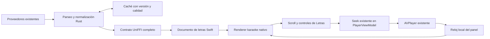

# PLAN-025 — Letras por palabra y experiencia karaoke en macOS

- Investigación original: 2026-10-20, America/Montevideo.
- Restauración: 2026-10-20, tras actualizar el checkout; recuperado de la conversación y de las fuentes conservadas de la investigación. El archivo y su entrada en el índice faltaban.
- Base local revisada al restaurar: `907ac01` (`docs: record verified GitHub privacy cleanup (FIX-227)`). El árbol estaba limpio antes de esta restauración.
- Estado: reabierto el 2026-10-21 por fallos funcionales reportados y reproducidos en build0145: clics que vuelven al inicio y seguimiento que desplaza el panel al fondo. Las comprobaciones anteriores de FIX-232/233 no acreditan corrección de estos síntomas. Causa corregida y build0146 Release/893 pruebas aprobadas; comprobación visible nueva bloqueada por Mac bloqueado. Acceso experimental y panel clásico conservados.
- Objetivo: activar tiempos reales por palabra/sílaba y mejorar el acabado visual, seguimiento, lectura, cobertura y recuperación de letras en Side B para Mac.
- Entrega inicial: macOS 15+, SwiftUI/AppKit, UniFFI y el AVPlayer existente.
- Tramo compartido: parser y contrato Rust aditivos para el detalle disponible a Mac y Windows; mantener un solo core. Windows conserva su presentación por líneas y contrato clásico, sin port visual en esta entrega.
- Referencias: [informe Octave y otras fuentes restaurado](../../plans/research/OCTAVE-2026-10-20.md), [evidencia resumida](../../plans/research/OCTAVE-2026-10-20-evidence.json), [reglas comunes](../../AGENTS.md), [Apple](../AGENTS.md), [core protegido](../../core/AGENTS.md), [workflow](../../.agents/WORKFLOW.md#planes).

## Reparación funcional reabierta — 2026-10-21

Usuario: cualquier canción en la última build; pulsar una frase vuelve al inicio y el seguimiento envía las letras al fondo. Reproducido mediante UI/AX sobre la **build0145 exacta**: Father Time pausada en 0:01/3:42, al pulsar una frase posterior volvió a 0:00 y seleccionó la primera frase. La firma y las suites anteriores no cubrieron este comportamiento del panel y el seek con un stream real.

Objetivo: que el segundo enviado por cada fila llegue sin deformación a AVPlayer y que la fila correspondiente al tiempo real permanezca visible/centrada durante seguimiento. Conservar manual/Volver, pausa, Genius y botón experimental. Sin compensaciones globales ni cambios de proveedor sin causa demostrada.

Trabajo con tres subagentes GPT-6.1 Sol, razonamiento medio: audio/VM y sus pruebas; panel/reloj/scroll y prueba hospedada; auditoría sólo de datos/parser compartidos. Integrador mantiene este plan, revisa contratos, secuencia pruebas/build y verifica la UI.

- [x] Reabrir la aceptación funcional; comprobar build/proceso y reproducir el clic con la UI real.
- [x] Auditar datos con fixtures reales: tres muestras Boidu conservan cues distintos de cero y 870 segmentos válidos; 48 focales Rust aprobadas/2 omitidas. No se identifica fix compartido necesario.
- [x] Regresiones con records UInt64 pasando por fetch real y tiempos medidos por AVPlayer tras cinco saltos; no se limita la aserción al target solicitado. Se descarta un harness AX hospedado que no materializa hijos SwiftUI: no es evidencia de fallo de layout. La interacción se verifica mediante CUA sobre la app visible nueva.
- [x] Causa principal demostrada y corregida: `UInt64?.map(Double.init)` selecciona `Double.init(bitPattern:)` y convierte3418ms en1.6887e-320. El controller usa conversión numérica explícita para inicio/fin. Los datos Rust/DB son correctos; el modelo elige foco3 a9s al recibir tiempos correctos. Se corrige también el recorte independiente de cues contra ventanas seekables parciales cuando el reproductor ya adopta una duración finita.
- [ ] Verificar seguimiento tras corregir tiempos: la conversión casi cero explica el foco en la última frase y el desplazamiento al fondo; no cambiar el layout sin un fallo independiente reproducido. Verificar las filas y los clics mediante CUA en la app visible con canciones reales, además del fetch real automatizado. No introducir APIs AX privadas para forzar el harness de pruebas.
- [x] Regresiones y suite oficial secuencial, diff revisado y [build0146](../../builds/macos/build-0146/BUILD.json) Release conservada mediante sideb-build-macos:893 ejecutadas aprobadas/15 omitidas, fuentes estables y firma/diez hashes verificados.
- [ ] Verificar clics y seguimiento en la nueva app con canciones reales y documentar resultados, límites, FIXES/PARIDAD y ruta de build. No declarar escucha/FPS validados por una captura. **Bloqueo externo:** CUA informa Mac bloqueado al intentar abrir0146; se pidió desbloqueo al usuario. FIX-234/PAR-038 actualizados sin afirmar QA nueva completada.

Evidencia nueva: `builds/karaoke-repair-qa/numeric-conversion-before-after.json`, logs `builds/karaoke-repair-focused.log` (dos fallos exclusivos del harness AX descartado; regresiones reales aprobadas) y `builds/karaoke-repair-build.log` (suite oficial final completa sin fallos). No se agregan letras de usuario ni payloads privados a Git.

QA visible al desbloquear: confirmar path0146; Father Time y De Música Ligera, cinco clics por canción hacia inicio/medio/final y atrás, combinando pausa/play; verificar tiempo de barra y frase seleccionada, observar dos cambios de frase sin clic, manual/Volver y regreso clásico/experimento. En Father Time a9s corresponde8959ms/foco3, nunca la última frase. Conservar builds previas y no modificar preferencias ajenas a esta prueba.

## Auditoría de rendimiento posterior — sólo reporte

Pedido del usuario del2026-10-21: estudiar carga/lag, sidebar y tareas de fondo sin optimizar Recomendados ni implementar todavía. [Reporte de rendimiento](research/LYRICS-PERFORMANCE-2026-10-21.md): rutas de red duplicables y respaldo tardío, coste de texto rico y ensayos aislados, sidebar retenida sin suspensión e inventario de trabajo activo/oculto. Las propuestas requieren revisión posterior; no se confunden con FIX-234 ni cierran su QA visible pendiente. La comparación con el borrador Gemini y el plan único de rendimiento están en [PLAN-026 consolidado](PLAN-026-fullscreen-lyrics-performance.md); no se ejecutan optimizaciones al consolidarlo.

## Qué se pidió y qué acordamos

La conversación comenzó investigando Octave como fuente de carátulas animadas, letras detalladas, créditos y contexto musical. Se descubrió que el core de Side B ya tiene soporte interno para palabras y traducciones, pero ese detalle no llega a las interfaces. El usuario pidió planear primero una mejora integral de Letras para macOS y estudiar proyectos open source más lindos y completos.

La propuesta fue conservar el audio y el diseño general de Side B, desarrollar un renderer nativo tomando **KaraokeText** como referencia visual y **Lyrimuse** como referencia funcional, y dejar **Braccato** como alternativa concreta si el prototipo nativo no alcanza el acabado y la composición buscados. **AMLL** y **Spicy Lyrics** también se investigaron. El experimento implementa un renderer propio; estos proyectos no se incorporaron como dependencias ni se copió su código.

Prioridad: datos correctos de extremo a extremo → reloj local preciso → karaoke nativo en el panel real → controles/estados/accesibilidad → cobertura y funciones avanzadas. Octave no es requisito para la primera entrega. Carátulas animadas, nuevos créditos y páginas editoriales quedan documentados como posibilidades separadas.

## Entrega experimental autorizada — 2026-10-20

El usuario pidió implementar con subagentes, dejando planeo/revisión al integrador, **sin reemplazar las letras existentes**. Se agrega un botón temporal en Letras para entrar a las nuevas opciones y volver al panel actual; el modo actual sigue siendo el predeterminado. Genius mantiene su acceso y comportamiento.

La implementación se divide en contratos/carga Rust aditivos, renderer/modelo Mac y conexión/estado/selector. Los archivos de cada encargo están separados y el integrador revisa contratos, concurrencia, Unicode, tiempo de audio y límites del scroll antes de cerrar.

- API experimental nueva `get_karaoke_lyrics` y records propios; conservar `get_lyrics`, `LyricsInfo`, `LyricLineInfo` y claves de caché actuales.
- Parser y caché experimentales aislados, con refresh acotado; empezar con fuentes existentes. No agregar Octave ni servicio nuevo de audio.
- Panel nativo experimental con modos Karaoke/Lectura, tiempos reales por palabra cuando existan, traducción disponible y opciones de presentación. Fallback explícito por línea/texto cuando falte detalle.
- Carga sólo al abrir el experimento; descarte por cuenta/reproducción/revisión y cancelación al ocultarse. Mantener letra válida al refrescar.
- El botón temporal permite la comparación; no se borra ni migra destructivamente el panel actual.
- La implementación es una primera entrega comprobable del plan; Lyricsfile adicional, fuentes nuevas, dúos/romanización y port visual Windows conservan seguimiento propio si no se completan aquí.

Verificación realizada: pruebas Rust y Swift, localización, build Mac numerada regenerando bindings, revisión estática/integrada y capturas aisladas. FPS y sincronización auditiva requieren medición/escucha real separadas. Registros del integrador: FIX-228 (tramo compartido) y FIX-229 (Mac).

### Implementación de esta primera entrega

- [x] Contrato aditivo `get_karaoke_lyrics` con palabras, fin, traducción e instrumental; la API y presentación clásicas permanecen disponibles.
- [x] Parser experimental eLRC/TTML/JSON y caché `karaoke:v1` separada con TTL, metadata y refresh. Boidu → LRCLIB, sin proveedor Octave nuevo.
- [x] Botón temporal «Probar nuevas letras» / «Letras actuales», con carga sólo al abrirlo y vuelta disponible en carga/error/vacío.
- [x] Controller con cancelación y descarte por cuenta/ocurrencia/revisión; mantiene documento usable durante actualización de la misma reproducción.
- [x] Renderer SwiftUI propio con TextAttribute/TextRenderer, palabras reales, composición multilineal y fallback por líneas/texto. No se incorpora código ni paquete de los proyectos investigados.
- [x] Karaoke/Lectura, traducción disponible, tamaño, movimiento y desfase local ±5 s; scroll manual/Volver y seek. Desfase positivo adelanta la letra y se resta al hacer seek.
- [x] Reloj AVPlayer local y boundaries, sin contador independiente ni observación global a 60 Hz; suspensión con pausa/buffering, ventana oculta y gaps sin cambios.
- [x] 19 pruebas Rust experimentales, 8 de controller y 13 de modelo/reloj/render; muestra TTML real retenida validada fuera de Git. Suites comunes: InnerTube97/core110/bridge112, sin fallos; 8 Rust ignoradas incluyen una muestra local opt-in ejecutada por separado.
- [x] 782 claves ES/EN verificadas y revisión del integrador sobre contratos, peticiones tardías, unidades/Unicode, caché, reloj, fallbacks y conservación del modo actual.
- [x] Capturas finales aisladas inspeccionadas a220/560px y panel420×600, con texto propio y AVPlayer vacío. Ajustes de revisión: ocultar etiqueta redundante del picker y evitar doble atenuación de filas futuras con palabras. Cuatro pruebas focales aprobadas con exportación de PNG.
- [x] Build oficial0141 Release aprobada con fuentes estables, firma, arm64 y diez hashes comprobados. Suite Swift final:239 XCTest y358 Swift Testing ejecutadas aprobadas,7live desactivadas; build total804 ejecutadas aprobadas/15 omitidas.

### Build local para probar

App: `builds/macos/build-0141/Side B.app`, desde la raíz del repositorio. [Registro de build](../../builds/macos/build-0141/BUILD.json). Comando oficial: `node Scripts/build-version.mjs macos`; todos los pasos aprobados y `sourceChangedDuringBuild:false`. Conserva versión pública1.2.6/build19, sin publicar release. La build0140 fue la primera integración y queda como diagnóstico previo a los últimos ajustes.

Recorrido: abrir la app → Ahora suena → Letras → **Probar nuevas letras**. Probar Karaoke/Lectura y el menú de traducción/tamaño/movimiento/desfase; volver con **Letras actuales**, incluso durante carga/error/vacío. Cuando falten tiempos reales por palabra, el pie indica Por línea o Sin sincronización.

Evidencia local ignorada: `builds/lyrics-experimental-qa/experimental-karaoke-{220,560}.png`, `experimental-lyrics-panel-420.png`, logs de QA/build y verificación final. Las capturas son fixtures propias; no prueban reproducción o cobertura real de canciones. La documentación de cierre se actualiza después de empaquetar sin retocar el código compilado.

Los checklists de etapas posteriores conservan el alcance de producción del plan original. No se declaran completos por entregar este experimento: Lyricsfile/YAML, selección de variantes/importación, dúos/romanización/voces, persistencia de opciones por canción y renderer Windows siguen pendientes. La lectura clásica conserva su parser anterior porque el pedido actual exige mantenerla; la corrección y el contrato rico se habilitan sólo en la nueva ruta.

Límites conocidos: el reloj puede mantener el pulso si el scroll manual deja la fila activa fuera del contenido montado; falta cruzar visibilidad de filas para esa optimización. La composición de CJK/emoji tiene fixtures; RTL, teclado/VoiceOver reales, escucha/sincronización auditiva, cobertura de catálogo e Instruments requieren validación propia. Las opciones de presentación/desfase duran la sesión del panel y el desfase se reinicia al cambiar de ocurrencia.

Registros: [FIX-228](../../FIXES.md#fix-228), [FIX-229](../../FIXES.md#fix-229) y [PAR-037](../../PARIDAD.md). Ninguna publicación, actualización de versión ni port visual Windows forman parte de esta entrega local.

## Diagnóstico contrastado con el código actualizado

### Seguimiento: TTML de Apple y alternativa Octave

Después de build0141 se investigó el acceso directo a letras de Apple y recursos de GitHub: [informe y propuesta](../../plans/research/APPLE-LYRICS-2026-10-20.md), [evidencia resumida](../../plans/research/APPLE-LYRICS-2026-10-20-evidence.json). Se repitieron consultas Boidu/Octave sobre tres pistas y se comprobó LRC.red por ISRC: el TTML conserva fronteras por sílaba que Octave agrupa. En De Música Ligera,109 spans se convierten en87 palabras con iguales tiempos exteriores;20 palabras combinan varios segmentos. Boidu ya puede entregar ese detalle; su procedencia interna puede ser LRC.red o Apple y no se debe rotular automáticamente como Apple oficial.

Próximo tramo propuesto, **pendiente**: fuente TTML directa LRC.red con matching conservador y Boidu existente, selector de fuente/alternativa Octave, conservar sílabas/voces/TTML y enriquecer el renderer. Acceso Apple autenticado es opcional posterior; los proyectos revisados exigen sesión de suscripción, token privilegiado o caché Music.app. No se implementa ni se recompila nada en esta investigación y las letras actuales siguen conservadas.

Indicadores de espera también pendientes: intro/interludios/outro a partir de secciones explícitas o intervalos sin letra temporizada, uniendo todas las voces antes de detectar huecos. Distinguirlos de la pista completamente instrumental. Tres puntos con progreso hasta la próxima entrada, pausa/seek/desfase coherentes y alternativa estática con Reducir movimiento; umbral de prueba por definir, sin atribuirlo a Apple. [Hallazgos y ejemplo real de tiempos](../../plans/research/APPLE-LYRICS-2026-10-20.md#seguimiento-indicadores-de-intro-e-interludio).

### Seguimiento: estilo de Octave observado en el navegador

El usuario pidió probar distintas canciones en su pestaña de Octave y planear cómo copiar estilo/tamaño para macOS. [Informe visual y plan ejecutable](../../plans/research/OCTAVE-LYRICS-VISUAL-2026-10-20.md), [medidas resumidas](../../plans/research/OCTAVE-LYRICS-VISUAL-2026-10-20-evidence.json). Se probaron Patience, De Música Ligera, DtMF y Blinding Lights; también anchos de 900/1134/1440 px y composición compacta de 600 px. La prueba fue visual, con volumen cero, sin validación auditiva. El navegador quedó con tamaño restaurado y reproducción pausada.

Entrega autorizada por el usuario: **implementada y empaquetada en [build-0143](../../builds/macos/build-0143/BUILD.json)** (`builds/macos/build-0143/Side B.app`), dentro de «Probar nuevas letras» (la `build-0142` queda como registro diagnóstico por una aserción de test sobre `AVPlayer().currentTime()` sin ítem, corregida antes de empaquetar `build-0143`). Registros [FIX-230](../../FIXES.md#fix-230) / [FIX-231](../../FIXES.md#fix-231):

- [x] A — Estilo: 36 pt bold como punto inicial frente a los 29 pt semibold actuales, altura visual objetivo 45 pt, padding de frase 10+10 pt, contexto al 40 % y escala 0,98, blur por distancia hasta 3 pt, máscara vertical y controles discretos. Relleno con gradiente más suave; sostenidas con elevación ~2 pt y escala de hasta ~1,13 por calibrar, sin reflow.
- [x] A — Centrar también primera/última frase mediante espaciadores calculados con el viewport. Es una variante experimental respecto de los límites naturales de FIX-064; el panel clásico permanece intacto. Scroll manual sigue mandando hasta Volver.
- [x] B — Modelo de intro/interludios/outro y tres puntos de 14 pt con gap 10 pt. Propuesta inicial de hueco mínimo 5 s para QA, no un umbral medido de Octave/Apple. Unir todas las voces y exigir límites fiables/duración para el outro.
- [x] B — Extender el reloj local para animar también una espera visible; pausa/buffering/oculto detienen el progreso visual. Mismo tiempo AVPlayer y desfase que las palabras, seek inmediato y opción estática con Reducir movimiento.
- [x] C — Preservar roles/agentes/grupos/sílabas TTML en el contrato experimental aditivo y representar voces de fondo independientes. En las muestras de Octave los ad-libs están al mismo tamaño, entre paréntesis o en filas normales; una capa vocal subordinada sería una mejora de Side B, no una copia verificada de esa web.
- [x] D — Pruebas unitarias/presentación (53 pruebas focales de `ExperimentalLyrics` y 842 ejecutadas en total en `build-0143`), capturas aisladas en `builds/lyrics-octave-qa/` (330/447/600 px, interludio y barrido 220/420/560 px sin reflow) y firma verificada. Validación auditiva/física con canciones reales e Instruments pendientes del usuario.

La parte visual A y las esperas B no necesitan agregar Octave como proveedor ni sustituir el renderer nativo. El selector de fuentes y las voces completas mantienen su tramo de datos separado; no llamar Apple oficial a TTML sin procedencia comprobada.

### Revisión del integrador posterior a build0143

Se conserva la build0143 ya probada por el usuario. Tres hallazgos acotados corregidos y comprobados en [build0144](../../builds/macos/build-0144/BUILD.json): prioridad del documento fresco rico frente al respaldo clásico, límites conservadores cuando se descartan palabras por cobertura incompleta y orden temporal de esperas cuando un fondo de un grupo antiguo termina después de una frase posterior. Caché experimentalv3 invalida resultadosv2 afectados. El indicador conserva altura durante cambios de foco.

Build0144 Release: `status: compiled`, `sourceChangedDuringBuild:false`,851 pruebas ejecutadas aprobadas/15 omitidas (97 InnerTube,122 core,239 XCTest y393 Swift Testing ejecutadas). Windows-bridge124 aprobadas por separado en Mac; no es validación nativa Windows. Firma, arm64, versión1.2.6/build19 y diez hashes comprobados. App: `builds/macos/build-0144/Side B.app`. Registros FIX-230/231 actualizados después del paquete; fuentes compiladas intactas.

Las capturas en `builds/lyrics-octave-qa/` son de composición sintética en ventanas ocultas: no prueban seguimiento interactivo ni escucha. Renderer aislado validado con75 dibujos y geometría45/90/225pt para1/2/5renglones; accesibilidad física y rendimiento requieren validación propia. Este tramo no agrega la API de Octave ni implementa el plan de sincronización/seek siguiente.

### Seguimiento: sincronización y seek — revisión contra build0144

El diagnóstico anterior se redactó tras una sesión de build0143. Se conserva como antecedente de ese intento, pero **no acredita causas raíz universales**: el código de0144 ya cambió y los tiempos de una sesión/stream no permiten fijar una compensación global de CoreAudio. El usuario pidió revisar este plan y ejecutarlo si tiene sentido.

#### Resultado de la revisión

| Propuesta anterior | Comprobación y decisión actual |
|---|---|
| Evitar lecturas antiguas mientras se realiza un seek | Confirmado: el observer periódico publica el tiempo anterior y el callback ignoraba `finished` e identidad del ítem. Implementar estado por revisión/ítem/ocurrencia, preview fijo únicamente durante pending y reconciliación con el tiempo real al terminar/fallar. |
| Piso fijo350ms o corrección universal−91ms | No justificado por evidencia reproducible. Se descarta. `seek` ya usaba tolerancias cero; conservarlas, sin adelantar el reloj ni sumar1ms a los versos. [Referencia Apple](https://developer.apple.com/documentation/avfoundation/avplayer/seek(to:tolerancebefore:toleranceafter:completionhandler:)); contrato también revisado en AVPlayer.h del SDK local. |
| Clic en letras sin duración / pista restaurada | Confirmado: el panel y el servicio abortaban o ni ofrecían botón. Usar segundos absolutos; clamp con duración válida si existe y pedir al VM resolver una pista restaurada. El último pedido queda ligado a cuenta/ocurrencia/canción; descartarlo al cambiar o fallar. |
| Reanudar toda pista pausada al pulsar letra | Se conserva el comportamiento de pausa de una pista ya cargada. Resolver una pista restaurada sí inicia la reproducción solicitada; un seek general no cambia por sí solo pausa/play. |
| Reanudar seguimiento y ampliar área clicable | Confirmado: click por fila reactiva seguimiento/centrado y toda la fila recibe hit-testing. Aplicar en los dos paneles sin sustituir el clásico. |
| Sustituir indiscriminadamente LazyVStack por VStack | No demostrado como causa y puede materializar hasta5000filas. El clásico ya utiliza VStack; conservar la carga diferida experimental mientras no haya reproducción medida que justifique otro contenedor. Unificar/reordenar lifecycle y centrar después de aplicar documento/clock actual. |
| Colapso de puntos y prioridad `has_words` | Ya corregidos en0144: geometría estable, esperas cronológicas y prioridad de detalle/cachév3. No rehacer estos cambios como si siguieran pendientes. |
| Quitar foco anterior en todos los interludios | Era la composición de Octave observada y adoptada, no prueba de bug. Mantenerla: los puntos gobiernan el scroll durante la espera y todas las palabras conservan su tiempo real. |
| LRCLIB exige duración / usar search siempre | Incorrecto según [documentación oficial](https://lrclib.net/docs): `/api/get` requiere título/artista y duración es opcional. Mantener endpoint; contrastar metadata presente y duración conocida, sin elegir el primer resultado de una búsqueda ni asumir un400 universal. |
| Boidu plain termina la búsqueda clásica | Confirmado: afecta al core compartido. Conservarlo como respaldo mientras se buscan letras sincronizadas; sin borrar caché clásica ni cambiar su contrato. Limitar caché experimental provisional cuando falta duración y evitar guardar fallback bajo tras un fallo transitorio. |

Las diferencias de versión/master entre letra y audio siguen siendo una causa posible de desfase: esta corrección no fabrica karaoke ni convierte coincidencias por título en identidad de grabación.

#### Ejecución autorizada — implementada y verificada en build0145

Registros: [FIX-232](../../FIXES.md#fix-232), [FIX-233](../../FIXES.md#fix-233); compatibilidad compartida en PAR-037 y comportamiento de seek Windows pendiente en PAR-038.

- [x] Servicio AVPlayer: snapshot observable idle/pending/completed/failed/cancelled, revisión y playbackID; rechazar completion viejo, congelar sólo el target pendiente, volver al tiempo real en completion/fallo/reemplazo y deadline cancelable de una ejecución, sin timer de reproducción paralelo.
- [x] Clock de letras: observar el snapshot por ocurrencia; actualizar inmediatamente un clic sin retener un reloj simulado, detener pulso por frame mientras pending y proteger callbacks de una generación anterior.
- [x] VM: `seekToLyric(seconds:)` para item cargado y pedido diferido para restaurado/resolviendo; último cue gana, cambio de cuenta/ocurrencia/error lo invalida y un item pausado permanece pausado.
- [x] Ambos paneles: segundos absolutos, área clicable completa y click reactiva seguimiento/centrado; conservar el botón temporal y el diseño clásico. Documento/resize se reconcilian después del estado vigente sin forzar seguimiento durante un refresh de la misma ocurrencia.
- [x] Core compartido: LRCLIB/get sin duración, matching conservador de metadata disponible, caché provisional de60s/errores y respaldo Boidu plain hasta buscar sincronizadas. Política experimentalv4, sin borrar datos clásicos.
- [x] Tests deterministas de callbacks/timeout/cancel, lecturas viejas, seeks consecutivos, pausa/buffering, desfase, restauración/cuenta/ocurrencia, matching/cache y providers. Prueba con archivo local silencioso separada de escucha de canciones reales.
- [x] Suites pertinentes, bindings por flujo oficial, build Mac numerada y verificación de firma/hashes/fuentes. Windows bridge en Mac no equivale a ejecución nativa Windows. Límites de QA física registrados y FIXES/PARIDAD actualizados.

Resultado integrado: [build0145](../../builds/macos/build-0145/BUILD.json), Release `compiled`, `sourceChangedDuringBuild:false`,889 pruebas ejecutadas aprobadas y15 omitidas (97 InnerTube +129 sideb-core +239 XCTest +424 Swift Testing ejecutadas;431 casos Swift incluyendo7 live omitidos). Las31 pruebas Swift nuevas cubren servicio17, reloj/seguimiento9 y reproducción/restauración5. Core focal49 aprobadas/4 ignoradas y windows-bridge131/8 ignoradas comprobados por separado en Mac. Los8 Rust omitidos incluyen muestras/live optativas. Cero fallos.

App para probar: `builds/macos/build-0145/Side B.app`; firma ad hoc, arm64, versión1.2.6/build19 y diez hashes revalidados. XCFramework/bindings regenerados;786 claves ES/EN verificadas. Build0143 funcional reportada por el usuario y builds previas conservadas. No se abre ni reemplaza la app en ejecución ni se publica release.

Revisión del integrador y revisión cruzada del VM/callsites sin hallazgos pendientes dentro de este alcance. Las pruebas con AVPlayer y archivo silencioso validan integración y preservación de pausa; no certifican precisión auditiva con streams reales, clic físico/VoiceOver ni FPS. Esa QA y las funciones futuras del plan siguen pendientes. La actualización documental de cierre es posterior al paquete; el código compilado permanece intacto. Continúan Boidu/Better Lyrics y LRCLIB: Octave es referencia visual, sin proveedor Octave nuevo.

### Diagnóstico histórico al restaurar

| Capa | Estado comprobado al restaurar | Consecuencia |
|---|---|---|
| [Modelo Rust](../../core/crates/sideb-core/src/lyrics.rs) | `LyricWord` tiene texto/inicio/fin; `LyricLine` incluye palabras y traducción; `Lyrics` incluye instrumental | Parte de la obtención y representación del detalle ya existe. No implica cobertura por palabra para todas las canciones. |
| [Contrato UniFFI](../../core/crates/sideb-core/src/lib.rs) | `LyricLineInfo` sólo tiene inicio/fin de línea y texto. `get_lyrics` descarta `words` y `translation`; `LyricsInfo` tampoco expone instrumental | Hay pérdida común de datos antes de Swift y Windows. |
| [Bridge Windows](../../windows/src-tauri/src/commands/lyrics.rs) y [tipos TS](../../windows/src/lib/player/lyrics.ts) | Repiten el contrato reducido a líneas | La corrección del contrato es compartida; no desarrollar dos modelos incompatibles. |
| [Caché](../../core/crates/sideb-core/src/db.rs) | Aciertos sin vencimiento; ausencias 24 h. La cadena usa primero el acierto cacheado | Una letra por líneas puede impedir buscar una versión con palabras. Algunas entradas ya pueden contener palabras: inspeccionar/migrar, sin borrar todo. |
| [Proveedores](../../core/crates/sideb-core/src/lyrics.rs) | Boidu primero si está habilitado; luego LRCLIB, YTM, NetEase, QQ, KuGou y respaldos de texto. LRCLIB sincronizado puede terminar la búsqueda antes de otros proveedores | Activar el dibujo no resuelve la calidad, prioridad ni cobertura. |
| [LRCLIB](../../core/crates/sideb-core/src/lyrics.rs) | `LrclibTrack` sólo lee instrumental, letras plain/LRC y duración | No aprovecha `hasWordSync` ni `lyricsfile` observados en la investigación original. |
| [Panel Mac](../Sources/SideB/Views/Fullscreen/FullscreenNowPlayingView.swift) | `SyncedLyricsPanel` usa un `Text` por línea, VStack y ScrollViewReader; resalta opacidad, peso, escala y brillo. `LyricTiming` sigue el último inicio y no usa fin de línea | No hay relleno por palabra, traducción ni tratamiento completo de voces simultáneas. |
| [Reloj de audio](../Sources/SideB/Services/Player/AudioPlayerService.swift) | Publica `currentTime` cada 0,1 s y expone `avPlayer` | Para un barrido continuo hace falta un reloj visual local ligado al tiempo preciso, sin subir toda la observación global a 60 Hz. |
| [Carga Mac](../Sources/SideB/ViewModels/PlayerViewModel.swift) | `lyricsTask`, token de reproducción y descarte de resultados obsoletos ya existen. Cada carga vacía `lyricsInfo` | Preservar guardas; añadir revisión de petición para cambios dentro de la misma pista y conservar letras válidas mientras se actualizan. |
| Identidad del panel | `.id(currentTrack?.videoId)` | Revisar repetición de la misma canción en otra ocurrencia y cambios de cuenta/reproducción. |

Antecedentes que se deben conservar: [FIX-064](../../FIXES.md#fix-064), scroll manual/seguimiento/límites naturales; [FIX-075](../../FIXES.md#fix-075), controles discretos; [FIX-077](../../FIXES.md#fix-077), saltos rápidos/tareas obsoletas; [FIX-157](../../FIXES.md#fix-157), presentación y selección de Genius. Sus comprobaciones históricas no equivalen a una validación nueva.

### Error eLRC reproducido de nuevo al restaurar

Se extrajeron las funciones actuales `parse_lrc`, `parse_lrc_time` y `parse_elrc` a un ejecutable Rust aislado, sin cambiar Side B. Entrada sintética propia:

```text
[00:01.00]<00:01.00>Uno <00:02.00>dos<00:03.00>
```

| Segmento | Resultado actual | Esperado para esta notación de inicio |
|---|---|---|
| `Uno ` | 1000 → 1000 ms | 1000 → 2000 ms |
| `dos` | 1000 → 2000 ms | 2000 → 3000 ms |
| Vacío | 2000 → 3000 ms | No crear palabra vacía |

El marcador anterior al texto se interpreta como fin; la primera palabra queda con duración cero. Se confirmó en la investigación original y se repitió con el código actualizado. Hay que fijar explícitamente la semántica de cada variante eLRC mediante fixtures antes de entregar el karaoke.

Otros riesgos detectados por lectura, pendientes de fixtures: TTML con spans anidados/namespaces/voces de fondo; y JSON donde se adivina segundos vs milisegundos con el umbral 500. No afirmar que todos los proveedores sufren esos fallos sin demostrar el caso concreto.

## Proyectos open source comparados

Se conservan las revisiones inspeccionadas, sin presentar sus versiones como la última disponible. Se leyeron README, LICENSE, manifiestos y componentes de cada candidato. Las licencias de software no conceden por sí solas permisos sobre letras, bases de datos o servicios externos.

| Proyecto / revisión | Tecnología y funciones | Cómo lo insertaríamos | Evaluación Mac |
|---|---|---|---|
| [KaraokeText](https://github.com/WillSuo-Github/KaraokeText/tree/08697a112d314aa360f9b2ebed3622181ab58ad8), MIT | SwiftUI, máscara suavizada por glifo, brillo, elevación y texto multilínea; manifiesto macOS 15 | Adaptar su dibujo a atributos con tiempos de cada palabra/sílaba dentro de un único Text | Base visual recomendada. Su API toma un inicio/fin para todo el texto: no consume directamente nuestro array de palabras. Aplicarla a una frase completa produciría un barrido aproximado, no sincronización real. |
| [Lyrimuse](https://github.com/Yudaotor/lyrimuse/tree/c4ed629c6f332352f8be3ef9799baf4c9413939e), GPL-3.0 | App Mac completa: palabras, traducción/romanización, dúos, voces de fondo, palabras sostenidas, superficies flotantes y ventana de letras | Estudiar/adaptar componentes pequeños de relleno, layout y reloj con la atribución correspondiente | Referencia funcional nativa más completa que nuestro panel. La app también lleva integración con reproductores y motor Go; no importar toda esa infraestructura. |
| [Braccato](https://github.com/better-lyrics/braccato/tree/394f1318ed504abbc5f01bde0e84006c5d4598d5), MIT | Motor Better Lyrics como web component: segmentos, traducción/romanización, voces de fondo, scroll, temas, pausas y seeks; core sin dependencias de ejecución externas | JS/CSS empaquetados localmente en WKWebView; letras/reloj desde Swift; seeks devueltos al reproductor existente | Mejor alternativa modular de motor completo. Paquete leído 1.16.11; demo observado 1.16.10. Fijar revisión/versión, sin CDN cambiante. |
| [AMLL](https://github.com/amll-dev/applemusic-like-lyrics/tree/ca0f41d67882d936c0365ffd99c16841ea2fa39d), AGPL-3.0-only | Motor web estilo Apple Music, animaciones/layout/scroll y herramientas TTML/LRC/YRC/QRC; ecosistema de editores | Core de letras en WKWebView con adaptador de modelo y reloj | Referencia visual fuerte y alternativa secundaria. Core inspeccionado 0.6.0; README buscaba mantenedores. Resolver obligaciones de licencia antes de reutilizar/distribuir. |
| [apple-music-lyrics](https://github.com/Takpap/apple-music-lyrics/tree/e402374f4d371d8709f6e091570b4a864e03b903), MIT | AppKit/NSAttributedString, parser TTML y resaltado por palabras/graphemes | Referencia de parser/pintado nativo sencillo | Respaldo más simple, menos continuo que máscara por ancho real. No trasladar su obtención desde la caché privada/local de Music.app. |
| [Spicy Lyrics](https://github.com/Spikerko/spicy-lyrics/tree/f4e471e2b5e483c81c59cc1eb7b7608e434df71f), AGPL-3.0 | Experiencia web amplia de letras con animación/énfasis/scroll, vinculada a Spicetify | Referencia de comportamiento o port de piezas sujeto a adaptación/licencia | Menor encaje directo que un componente aislado; no traer el host Spotify ni sus servicios como dependencia de nuestro panel. |

Conclusión de la comparación: Lyrimuse es una referencia de producto Mac más completa; Braccato y AMLL ofrecen motores visuales más ricos. KaraokeText es una pieza pequeña adaptable, no un sistema de letras completo. Se recomienda adaptar la pieza adecuada y conservar la arquitectura existente de Side B.

### Evidencia de la investigación original

- KaraokeText: pasó `swiftc -typecheck -parse-as-library -target arm64-apple-macosx15.0` sobre sus tres fuentes con Swift 6.4 y SDK local de Xcode. No se instaló ni se ejecutó dentro de Side B. No acredita runtime en un Mac con macOS 15.
- Braccato: se abrió su [demo](https://braccato.boidu.dev/), se examinó la pantalla y se activó Play; cambió a Pause y avanzó el progreso. No se midieron audio, fluidez ni consumo.
- AMLL: se abrió el [playground](https://amll.dev/playground/); requería cargar recursos y no se validó reproducción.
- Lyrimuse: se examinó la [imagen oficial](https://raw.githubusercontent.com/Yudaotor/lyrimuse/c4ed629c6f332352f8be3ef9799baf4c9413939e/docs/images/hero-surfaces.jpg), el código de KaraokeFill y WrappedKaraokeRows, y el manifiesto. No se instaló/ejecutó la app.
- Se leyeron las licencias de los seis candidatos, incluida la del paquete core de Braccato.

Estas comprobaciones se recuperan del trabajo previo y de sus fuentes conservadas. Al restaurar se releyó Side B y se repitió el caso eLRC; no se repitieron las demos ni todas las consultas externas.

## Arquitectura recomendada



### Contrato compartido y formatos

Añadir `LyricWordInfo { text, start_ms, end_ms }`, palabras y traducción en `LyricLineInfo`, e instrumental en `LyricsInfo`. Los consumidores pueden seguir dibujando sólo líneas; actualizar todos los constructores/fixtures y comprobar Windows. Regenerar bindings y XCFramework por el flujo oficial, sin editar bindings a mano ni validar contra binarios viejos.

El texto exacto y las unidades son parte del contrato. Normalizar segundos/milisegundos según la fuente, validar tiempos finitos/no negativos y rangos crecientes, preservar signos/espacios y no inventar palabras uniformemente distribuidas entre el inicio y fin de una línea. Si no hay tiempos fiables, usar sincronización por línea; si tampoco hay líneas temporizadas, mostrar texto normal.

Para TTML complejo, evaluar un parser XML estructurado en lugar del recorrido por subcadenas, con namespaces, spans anidados, entidades y espacios. Dúos/voces de fondo requieren ampliar el modelo y reconocer sus roles; no prometer ese soporte sólo por tener un array de palabras. Romanización y voces pertenecen a la etapa avanzada.

### Caché, selección y disponibilidad

Mantener letra usable al intentar conseguir más detalle. Versionar parseo/caché y leer registros anteriores con defaults; detectar calidad real de lo guardado. Revalidar de forma acotada entradas sin palabras o de parser anterior cuando corresponda, conservándolas como respaldo. No vaciar indiscriminadamente la caché ni tocar biblioteca/cuenta.

La primera letra disponible no debe esperar a todas las fuentes. Después se puede buscar una mejora de calidad con presupuesto limitado, evitando una carrera ilimitada de proveedores y sustituciones constantes. Una selección manual debe ganar a una respuesta automática tardía.

Una caída de red, un 401/429/503 o un parseo fallido no demuestra ausencia de letras. Distinguir found/not-found/error, respetar `Retry-After` y evitar negativos duraderos por errores transitorios. La renovación también necesita revisión de petición dentro de la misma canción.

### Reloj y render nativos

- Conservar la frecuencia actual de `AudioPlayerService.currentTime` para el resto de la app. Crear `LyricsPlaybackClock` inyectable que consulte el tiempo preciso de `avPlayer` y el estado efectivo de reproducción.
- Un pulso local de hasta 60 Hz actualiza sólo las líneas/segmentos que cambian de aspecto. Pausar cuando no hay cambio visual, se pausa el audio, hay espera de datos o el panel/ventana está oculto o minimizado. Evaluar 30 Hz en ahorro de energía con mediciones.
- `isPlaying` expresa también intención de play; no asumir avance audible sólo por ese booleano. Revisar `timeControlStatus` y el tiempo real. No incrementar un contador de karaoke sumando deltas por frame.
- Seek, buffering, cambio de item, cuenta, pista u ocurrencia invalidan el estado anterior. Recalcular directamente desde el tiempo actual sin reproducir animaciones viejas ni suavizar el reloj con retraso respecto al audio.
- Construir un único `Text` compuesto con `TextAttribute` por segmento temporizado y dibujarlo con `TextRenderer`. El layout de SwiftUI resuelve glifos, kerning y saltos; evitar un HStack de palabras.
- Preparar documento, asociación de segmentos a rangos y geometría fuera del trabajo por frame; invalidar al cambiar texto/ancho/tipografía. Tratar ligaduras, acentos combinados, emoji, idiomas sin espacios y RTL como casos explícitos.
- Si la composición o rendimiento no alcanzan, evaluar AppKit/CoreText como respaldo nativo y comparar Braccato/WKWebView antes de comprometer el renderer definitivo.

### Experiencia de Letras

Primera entrega: barrido suave de cada palabra/sílaba con su tiempo real, pendientes atenuadas, cantadas claras y brillo/elevación contenidos. Conservar fondo y distribución general de Ahora suena. No cambiar la métrica tipográfica en cada frame.

Mantener scroll manual y Volver a la letra actual. El progreso de palabras nunca dispara scroll: sólo cambia el foco de línea/grupo. Respetar los límites naturales de FIX-064 sin medio panel vacío al principio/final. Clic en una línea temporizada usa el seek existente; Space, foco y gestos siguen funcionando.

Distinguir carga, instrumental, vacío y error recuperable; conservar letras válidas durante actualización de la misma pista. Traducción existente debajo del original, activable desde un menú discreto. Tamaño, movimiento y ajuste local de desfase por canción en opciones, sin una cabecera de diagnóstico invasiva. Definir el signo del desfase una vez y aplicarlo coherentemente a highlight, seguimiento y seek.

Genius conserva acceso, anotaciones, texto seleccionable y popovers. Los rangos de su letra no son automáticamente los de otra fuente; no superponer anotaciones mediante coincidencia ingenua de offsets. La unificación visual de controles no implica fusionar documentos incompatibles.

Con Reducir movimiento, conservar la información temporal y eliminar elevación/glow/scroll animado. VoiceOver debe leer frases completas y acciones comprensibles, no cientos de glifos como elementos separados. Comprobar contraste, transparencia reducida y teclado.

### Alternativa lista para evaluar: Braccato en WKWebView

Empaquetar sólo JS/CSS del renderer y un documento local transparente dentro del panel. AVPlayer sigue siendo el único audio; ninguna descarga, cookie o clave de proveedor se traslada a la web.

Adaptación: `timeMs → startTimeMs`, `endTimeMs - timeMs → durationMs`, `line.text → words` y segmentos temporizados → `parts`. El reloj `currentTime` del componente usa segundos; el documento usa milisegundos. Una línea sin fin requiere regla explícita de siguiente inicio/duración, sin fabricar tiempos internos.

Enviar documento por revisión y estados de reloj acotados; usar `playing`/`tickOptions` según la versión fijada. El host recibe seeks y usa el scroller del panel. Validar tiempos finitos/duración, asociar mensajes a generación y retirar handlers al desmontar. Argumentos estructurados WebKit, sin interpolar letras como JavaScript. Sin navegación remota ni audio HTML.

Criterio de elección frente a nativo: misma fixture, composición de texto, acabado perceptual, respuesta a seek, teclado/VoiceOver, memoria y consumo dentro de Side B. La demo web no valida WKWebView ni el fullscreen de nuestra app.

## Etapas ejecutables

### 0. Investigación y recuperación — completada

- [x] Auditar modelo, contratos Mac/Windows, render Mac, reloj, caché y antecedentes.
- [x] Comparar seis proyectos con licencias, revisiones e integración posible.
- [x] Registrar el typecheck Swift y la exploración visual original con sus límites.
- [x] Reproducir eLRC y volver a comprobarlo con el código actualizado.
- [x] Recuperar informe Octave y evidencia resumida sin letras completas ni URLs firmadas.
- [x] Recomendar ruta nativa y describir alternativa web/criterios de decisión.

### 1. Datos correctos de extremo a extremo — tramo compartido

- [ ] Fixtures sintéticos eLRC, TTML, JSON: marcadores previos/posteriores, espacios, Unicode, tiempos ausentes/cero/invertidos, unidades y canciones de más de 500 s.
- [ ] Corregir eLRC y eliminar inferencias ambiguas de unidades en los adaptadores afectados. TTML estructurado donde los casos de prueba lo requieran.
- [ ] Exponer palabras/traducción/instrumental en el contrato único; actualizar construcciones de records y comprobar consumidores Tauri/TS sin implementar aún su karaoke.
- [ ] Versionar resultados de parseo/caché con lectura compatible y revalidación acotada; mantener datos anteriores válidos.
- [ ] Regenerar bindings/XCFramework por el flujo oficial y demostrar que una fixture conocida llega intacta a Swift.

Cierre: sin pérdida de texto/timestamps, sin red para la verificación determinista y con fallback de líneas operativo en ambas plataformas.

### 2. Prototipo nativo — primera mejora visible en Mac

- [ ] Extraer `SyncedLyricsPanel` de FullscreenNowPlayingView a componentes de Letras, conservando contenedor y gestos.
- [ ] Implementar reloj local y renderer de atributos temporales; empezar con la tipografía de Side B.
- [ ] Probar barrido real, pausa, resume, seek y wrapping con texto propio.
- [ ] Comparar nativo/Braccato como referencia con inglés/español, CJK, RTL y frases largas. Elegir renderer antes de extender todo el producto.
- [ ] Si se adapta código, fijar revisión y agregar atribución/avisos; paquete sólo si resulta más mantenible que una adaptación pequeña.

Cierre: sincronización real, layout estable, texto completo accesible y ningún refresco de palabras que reconstruya portada, Inicio o cola. Compilar no demuestra fluidez.

### 3. Experiencia usable en Mac

- [ ] Peticiones con generación de reproducción y revisión de letras; impedir sustituciones tardías al cambiar fuente dentro de la misma pista.
- [ ] Scroll manual/Volver/límites naturales; seek y repetición de la misma canción como otra ocurrencia.
- [ ] Traducción disponible y estados instrumental/vacío/error; no vaciar la letra útil durante actualización.
- [ ] Menú discreto de refrescar/tamaño/traducción/desfase; persistencia local por identidad estable y significado del signo documentado.
- [ ] Localización ES/EN, VoiceOver, contraste, Reducir movimiento/transparencia, teclado y texto grande.
- [ ] Genius y sus anotaciones/selección/popovers conservados.

### 4. Cobertura y funciones avanzadas

- [ ] Leer `hasWordSync`/`lyricsfile` de LRCLIB mediante YAML validado/acotado y tolerancia a versión; mantener LRC como respaldo porque Lyricsfile es un borrador.
- [ ] Medir proveedores actuales antes de alterar prioridades; mejorar calidad sin retrasar la primera letra ni multiplicar consultas sin control.
- [ ] Modelo/render de dúos y líneas superpuestas, voces de fondo, romanización disponible e interludios basados en intervalos reales.
- [ ] Evaluar selector de variantes y carga/importación local LRC/TTML en una entrega posterior, con procedencia y validación.
- [ ] Evaluar Octave/Unison sólo si mejoran la muestra. Octave necesita correspondencia de catálogo en el flujo probado; aclarar sus condiciones de uso externo antes de distribuir.

### 5. Validación y entrega

- [ ] Tests focales de parseo, contrato, caché, reloj, rangos/Unicode y respuestas obsoletas; después suites apropiadas. Proveedores reales separados de tests deterministas.
- [ ] Para el tramo compartido: `cargo test --locked --manifest-path core/Cargo.toml -p innertube -p sideb-core` y `cargo test --locked --manifest-path core/Cargo.toml -p sideb-core --features windows-bridge`.
- [ ] `swift test --package-path apple`; comprobaciones Windows de los consumidores tocados. Informar sin atribuir validación nativa a checks ejecutados en Mac.
- [ ] Build Mac numerada mediante [sideb-build-macos](../../.agents/skills/sideb-build-macos/SKILL.md) y `Scripts/build-version.mjs`, regenerando XCFramework/bindings. No compilar contra un binario viejo.
- [ ] QA visual/auditiva: al menos 12 pistas diversas más fixtures; pausa/buffering/seeks/saltos rápidos/cuenta/repetición/resize/panel oculto/vuelta de Genius. Para comparar cobertura, muestra de 30–50 pistas con coincidencia correcta de versión.
- [ ] Instruments A/B en el mismo escenario/Mac/build: CPU/GPU, frames largos, asignaciones y memoria. Verificar reposo oculto/pausado y trabajo sólo en líneas relevantes; no prometer FPS sin medir.
- [ ] Registrar fixes realmente implementados en FIXES, paridad del karaoke Windows pendiente y resultados/ruta de build en este plan. No marcar pendientes como resueltos por tests o compilación solamente.

## Mapa de archivos previsto

| Ámbito | Archivos existentes / nuevos propuestos |
|---|---|
| Tramo común | `core/crates/sideb-core/src/lyrics.rs`, `lib.rs`, `db.rs` si requiere versión de caché y fixtures/tests sintéticos. |
| Contrato Windows | `windows/src-tauri/src/commands/lyrics.rs`, tipos/fixtures que construyan records; sólo compatibilidad con el cambio común en esta fase. |
| Datos/estado Mac | `PlayerViewModel.swift`, modelo de documento detallado/revisión de petición; adaptador local antes de modificar el servicio de audio. |
| Render Mac | Nuevos `Views/Fullscreen/Lyrics/SyncedLyricsPanel.swift`, `KaraokeTextRenderer.swift`, `LyricsPlaybackClock.swift` y auxiliares si hace falta. Los nombres son propuesta, no archivos existentes. |
| Integración | `FullscreenNowPlayingView.swift`, localización y preferencias; Genius sólo donde la integración lo exija. |
| Tests Mac | Ampliar LyricTimingTests y añadir reloj, Unicode/rangos, fallback, seguimiento, generación y contrato detallado. |
| Dependencias/avisos | `apple/Package.swift` sólo si se elige paquete; `THIRD_PARTY_NOTICES.md` cuando se reutilice código. No depender de ramas remotas cambiantes. |

Revisar nuevamente `git status` y diffs al implementar; este plan no autoriza a reemplazar cambios concurrentes ni a modificar el core por necesidades exclusivas Mac.

## Criterios de aceptación

- Palabras válidas se iluminan según sus tiempos; sin ellas funciona el fallback por línea; sin tiempos queda texto legible. No fabricar karaoke con una repartición uniforme de la frase.
- Texto conserva signos, espacios, Unicode, ligaduras, emoji y saltos. RTL y CJK validados, rangos estables al cambiar ancho/tamaño.
- Pausa/buffering no adelantan el relleno; seek/cambio de reproducción no arrastran animación anterior ni respuestas viejas.
- Scroll manual conserva prioridad hasta Volver; refresco por palabra no desplaza la lista; límites naturales al principio/final.
- Estados y fuente visibles/accesibles sin controles invasivos; traducción opcional; Genius conserva sus acciones y selección.
- El renderer deja de consumir por frame oculto, pausado o sin cambios visuales. No hay observación global a 60 Hz.
- Audio, sincronización auditiva, fluidez, memoria y consumo tienen evidencia por separado. Dúos/voces de fondo sólo se anuncian tras comprobarlos.

## Fuentes concretas para retomar

- Apple: [TextRenderer](https://developer.apple.com/documentation/swiftui/textrenderer), [TextAttribute](https://developer.apple.com/documentation/swiftui/textattribute), [AVPlayer.timeControlStatus](https://developer.apple.com/documentation/avfoundation/avplayer/timecontrolstatus-swift.property).
- [KaraokeRenderer de KaraokeText](https://github.com/WillSuo-Github/KaraokeText/blob/08697a112d314aa360f9b2ebed3622181ab58ad8/Sources/KaraokeText/KaraokeRenderer.swift) y [API de reloj externo](https://github.com/WillSuo-Github/KaraokeText/blob/08697a112d314aa360f9b2ebed3622181ab58ad8/Sources/KaraokeText/View%2BKaraoke.swift).
- Lyrimuse: [KaraokeFill](https://github.com/Yudaotor/lyrimuse/blob/c4ed629c6f332352f8be3ef9799baf4c9413939e/lyrimuse/Sources/LyrimuseCore/Lyrics/KaraokeFill.swift), [WrappedKaraokeRows](https://github.com/Yudaotor/lyrimuse/blob/c4ed629c6f332352f8be3ef9799baf4c9413939e/lyrimuse/Sources/lyrimuse/UI/WrappedKaraokeRows.swift).
- [Referencia completa de Braccato](https://github.com/better-lyrics/braccato/blob/394f1318ed504abbc5f01bde0e84006c5d4598d5/packages/core/README.md).
- [LRCLIB](https://lrclib.net/docs), [Lyricsfile](https://github.com/tranxuanthang/lyricsfile), [Better Lyrics API](https://lyrics-api-docs.boidu.dev/reference/get-lyrics), [Unison](https://lyrics-api-docs.boidu.dev/unison).

## Estado de la etapa de restauración documental

Antes del pedido posterior de implementar, se restauraron documentación y evidencia resumida, se actualizó el índice y se verificaron estructura/enlaces locales. Se releyó el código actual y se repitió el caso eLRC aislado. En esa etapa documental no se modificó código de la app, providers, cachés de usuario, contratos o bindings ni se compiló Side B. Las comprobaciones originales se etiquetan como originales para no convertirlas en validación nueva. La implementación autorizada posteriormente y sus verificaciones se registran al principio de este documento y en FIX-228/229.

## Nueva selección predeterminada — 2026-10-21

Pedido posterior del usuario: nuevas letras por defecto y mismo espacio que las originales. Esta decisión reemplaza la activación optativa/cabecera temporal de la primera entrega, conservando el panel clásico como opción.

- [x] Iniciar Letras con el renderer nuevo; conservar selección al cambiar pestañas y prioridad de Genius.
- [x] Retirar cabecera temporal y fila de Karaoke/Lectura; usar el alto completo del panel original.
- [x] Menú superpuesto de tres puntos arriba a la derecha: Karaoke/Lectura, fuente, traducción, movimiento, tamaño, desfase/valor actual, actualizar y Letras originales. Retorno disponible en carga/error/vacío.
- [x] Revisar Windows y actualizar PAR-037; renderer/menú destino pendientes.
- [x] App Release compilada y empaquetada en `builds/macos/build-0147/Side B.app`. Suite Swift interrumpida por pedido posterior del usuario: empaquetar sin más pruebas por cuota. QA visual y suite completa pendientes; BUILD.json `status: packaged`, `testsComplete:false`.

Registro: [FIX-235](../../FIXES.md#fix-235). Verificación de localización: 786 claves ES/EN aprobadas. La lectura clásica y el seek existente se conservan.

## Seguimiento FIX-239 — estilo compartido y scroll manual

Pedido2026-10-21: originales con el mismo tamaño/fuente/blur/layout que las nuevas y blur únicamente siguiendo automáticamente en ambos renderers. Implementado en Mac mediante presentación compartida (tamaño/modo/manual) y helpers comunes, sin publicar tiempo de audio en el host. Original como respaldo mientras falta el documento rico; ajustes/manual conservados al cambiar renderer de la misma ocurrencia. Blur se quita en scroll manual y vuelve con Volver/clic/nueva ocurrencia. No se generan timings de palabras ausentes. Tres regresiones nuevas aprobadas y revisión Luna/integrador; build0155 Release aprobada,959 ejecutadas/17 omitidas, fuentes estables/firma/diez hashes. [Paquete](../../builds/macos/build-0155/Side%20B.app). QA visible del usuario pendiente; sin perfiles de FPS. Ver [FIX-239](../../FIXES.md#fix-239) y [guía Windows](../../PARIDAD.md#lyrics-windows-handoff). Rendimiento instrumental y port Windows pendientes.
