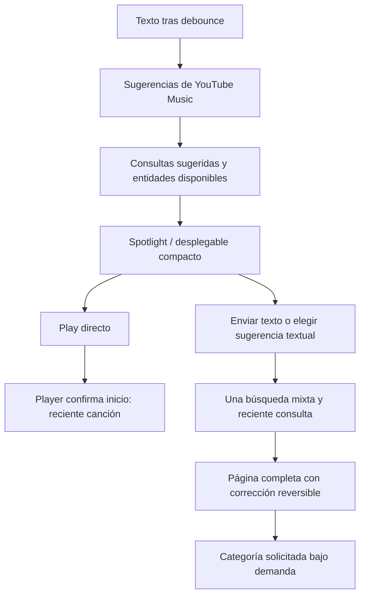

# Motor e interfaz de búsqueda de Side B

- Fecha: 2026-10-12 (America/Montevideo).
- Estado: implementado y validado automáticamente; Spotlight/Play/reciente verificados en Mac build-0089. Revisión visual de página completa/corrección y ejecución nativa Windows pendientes.
- Objetivo: aprovechar el motor de YouTube Music para sugerencias, correcciones y relevancia; presentar sus respuestas con una UI compacta y coherente en Mac y Windows.
- Alcance: core compartido, UniFFI/Tauri, Spotlight, sugerencias del campo, página completa, cachés y recientes existentes.
- Exclusiones: índice global, servidor nuevo, ranking por afinidad propio, LLM por consulta, cambios al reproductor, instalación/publicación y sincronización de recientes entre equipos.
- Evidencia: [investigación y búsquedas realizadas](research/SEARCH-2026-10-12.md). Ocho consultas originales y cuatro de seguimiento; no equivalen a un corpus40 evaluado.
- Antecedentes: [PLAN-005](PLAN-005-search-library.md), FIX-165/169/173; [controles PLAN-007](PLAN-007-unified-controls.md), FIX-174/177; [enlaces PLAN-006](PLAN-006-featured-artist-links.md), FIX-171. Paridad: PAR-027.

## 1. Decisión acordada

Side B ya consulta el catálogo de YouTube Music mediante InnerTube. Se amplía ese adaptador para consumir también sus sugerencias y correcciones. Google decide las coincidencias y el orden que entrega; Side B coordina solicitudes, conserva identidades y muestra resultados y acciones con claridad.

Esto usa un endpoint **interno**, no una API pública oficial de Google. No promete una copia exacta de la web: sesión, idioma, región y experimentos del proveedor pueden cambiar los resultados. La versión inicial mantiene las sugerencias anónimas para no registrar prefijos en el historial remoto de la cuenta. No se simula personalización de Google con datos locales.

La propuesta anterior de normalización avanzada, fuzzy matching, afinidad, pesos de popularidad y RRF se difiere. Tampoco se condiciona esta entrega a construir un índice de escuchas o evaluar40 consultas para ajustar pesos que no vamos a introducir.

## 2. Hallazgos que motivan el cambio

| Caso probado | Observación | Decisión |
|---|---|---|
| `kany` | Spotify ofreció Kanye; YouTube público mostró textos de Kanye y entidades de Kany García. | Mostrar textos sugeridos separados de entidades; conservar ambigüedad sin prometer Kanye primero. |
| `kayne west` | YouTube corrigió a Kanye y ofreció volver al original. | Corrección explícita y reversible, sin reescribir silenciosamente el campo. |
| `kany garcia` | Los proveedores encontraron Kany García. | No forzar artistas populares sobre una búsqueda específica. |
| `kany w` | Texto sugerido de Kanye; Side B mezcló principal Kanye con canciones de Kany García. | No fabricar asociación artista/canciones; conservar créditos reales y distinguir las alternativas. |
| `runaway` / `runaway kanye west` | Contexto, proveedor y tipo audio/video cambiaron la respuesta. | Respetar IDs/versiones y mostrar tipo; sin deduplicar por título ni imponer una versión universal. |
| Play desde Spotlight | Side B build-0087 confirmó historial de la pista. | Conservar FIX-173 y probarlo al cambiar el origen de datos. |

Las búsquedas y fuentes completas están en el registro enlazado. La repetición de `kany` cambió sugerencias de YouTube; no se aisló la causa y no demuestra por sí sola personalización.

## 3. Contrato compartido mínimo

Se añaden APIs compatibles, sin eliminar `searchAll` y sin modificar a mano bindings:

```text
searchSuggestions(query) -> SearchSuggestionsRecord
  queries: [String]
  results: SearchResultsRecord

searchCatalog(query, recordHistory, ignoreSpelling) -> SearchCatalogRecord
  results: SearchResultsRecord
  correction: SearchCorrectionRecord?
    query: String
    applied: Bool
```

- Sugerencias: endpoint interno `music/get_search_suggestions`, `input=query`. Parsear textos y entidades reales si existen; una respuesta de sólo textos es válida.
- Catálogo: búsqueda existente con corrección tipada. `ignoreSpelling=true` solicita literalmente el original cuando el usuario lo elige; no altera el campo ni agrega otro reciente por reintento. Los filtros en ese contexto proyectan la respuesta mixta exacta y muestran una leyenda; no vuelven a consultar endpoints que podrían corregirla otra vez. Son un subconjunto de esa respuesta, no una nueva categoría completa.
- Preservar medios originales, IDs, browseIDs, tokens, créditos, flags audio/video y orden dentro de las listas del proveedor. No inferir créditos para acomodar el diseño.
- UniFFI y Tauri exponen la misma semántica; DTOs Windows camelCase. Consumidores Swift/TypeScript se actualizan juntos.
- Mantener los métodos anteriores para radio, resolución de artistas y consumidores ajenos a esta UI.

El core protegido cambia porque el problema afecta ambas apps: faltan sugerencias/correcciones en el adaptador común. UI y política de foco permanecen en cada shell.

## 4. Flujo y presupuesto de solicitudes



- Escribir: una petición de sugerencias tras debounce; reutilizar caché. Una respuesta sólo de textos se muestra como tal, sin fabricar entidades ni lanzar un mixto adicional. Enter permite explorar esa consulta.
- Enter/Ver todos/sugerencia textual: una búsqueda mixta. Categoría específica sólo al solicitarla, reutilizando su caché.
- Cambio de cuenta: limpiar cachés e invalidar generaciones/respuestas privadas.
- Consultas/revisiones anteriores nunca reemplazan una respuesta nueva. Esto descarta resultados tardíos; no se afirmará cancelación HTTP real si el bridge sólo invalida la respuesta.
- Cachés por consulta y contexto, TTL y tamaño máximo. Mac y Windows documentan límites concretos al verificar la implementación.
- Mantener errores recuperables y reintento sin sumar historial ni reordenar selección inesperadamente.

Se difieren coordinación global entre ventanas, cancelación por suscriptor, índices persistidos y continuación paginada nueva. No introducir infraestructura que el flujo actual no necesita. La virtualización de listas/cards existente se mantiene.

## 5. Presentación y orden

El proveedor resuelve relevancia. En sugerencias se conserva el orden de todas sus entidades, incluso si alternan canción, artista y álbum. En la página se agrupa por tipo conservando el orden de cada colección; no se calcula afinidad/pesos propios ni se promete preservar un orden global entre secciones que el contrato de catálogo todavía no representa.

- Sugerencias **textuales** separadas de resultados **reproducibles/navegables**. Al elegir un texto se envía exactamente esa sugerencia como acción explícita.
- Principal compacto, sin estrella + TOP RESULT + insignia redundantes.
- Canciones con artista visible cuando se conoce y duración a la derecha. Si faltan créditos aplicar sólo recuperación compatible de FIX-169.
- Un tema de otra persona puede ser una alternativa; no aparece como canción asociada al artista principal por compartir palabras.
- Dedupe por identidad real, nunca por parecido de título; no fusionar audio/video, estudio/directo ni variantes con IDs distintos.
- Un fallo de portadas no debe convertir toda la búsqueda en error ni bloquear navegación.

## 6. Nueva UI

### Spotlight y sugerencias del campo

Un solo contenedor de cristal, cabecera con campo, cuerpo compacto y pie estable «Ver todos los resultados». Sin portadas gigantes ni vidrio adicional por fila. Referencia de densidad: filas58pt/px, portada42, título15 y metadatos12; ajustar al espacio real sobre el player y ventanas pequeñas.

Vacío muestra recientes existentes. Al escribir muestra consultas del proveedor y entidades en bloques distintos. Carga y error conservan salida por Enter. El principal usa la misma densidad que las filas, con tipo claro y acciones existentes. Hover de artistas/feats sólo cambia brillo: sin subrayados.

Flechas/Enter/Escape, foco, selección estable, menús y destinos siguen funcionando. Activar texto y activar pista son acciones distintas, también para accesibilidad.

### Página completa

Cabecera sobria, campo y filtros superiores de la familia Library/Playlist: Todo, Canciones, Artistas, Álbumes, Playlists y Videos según preferencias. Categoría48, acciones40, utilidades32; no tocar fullscreen.

Principal horizontal compacto, canciones en listas existentes, álbumes/playlists en cards compartidas y artistas circulares. Se conserva virtualización. Corrección de Google visible con acción de buscar el texto original. No añadir hero decorativo ni paneles translúcidos por cada elemento.

ES/EN, títulos largos y tamaño mínimo se verifican antes de dar por cerrada la interfaz. Pruebas automáticas no sustituyen inspección nativa de materiales ni Narrator/VoiceOver.

## 7. Historial por intención, sin migración destructiva

| Evento | Reciente local |
|---|---|
| Escribir, hover, cargar sugerencias/categorías, corregir metadatos | Ninguno |
| Play directo en Spotlight/desplegable | Canción elegida después de confirmar reproducción real, una vez |
| Enter / Ver todos / elegir consulta sugerida | Consulta enviada, una vez |
| Play desde página después de Enter | Mantener consulta; no agregar canción por ese flujo |
| Buscar original tras corrección / reintentar | No agregar otra entrada |
| Abrir artista/álbum/playlist desde sugerencia | Mantener comportamiento actual, sin nuevo tipo de reciente |
| Error, petición reemplazada o cambio de cuenta | No confirmar pista obsoleta |

Conservar JSON Mac/localStorage Windows,50entradas por cuenta, identidad/dedupe, eliminar/deshacer y FIX-173. No usar la tabla compartida de escuchas como perfil personal sin antes resolver aislamiento de cuenta y borrado.

## 8. Etapas y revisión

### A. Investigación y alcance

- [x] Leer ambas implementaciones y antecedentes.
- [x] Probar ocho consultas originales y cuatro de seguimiento; documentar límites.
- [x] Adoptar proveedor primero y diferir ranker propio según decisión del usuario.
- [x] Verificar en vivo anónimo sugerencias textuales/entidades y corrección del proveedor.

### B. Core y bridges

- [x] Parseo tipado de sugerencias/corrección con fixtures sanitizadas.
- [x] Preservar medios/orden/identidades y compatibilidad existente.
- [x] Exponer UniFFI/Tauri y revisar autenticación/historial.
- [x] Pruebas Rust con/sin windows-bridge; regenerar bindings mediante build versionada.

### C. Mac y Windows

- [x] Consumir sugerencias reales y textos separados; admitir respuestas de sólo texto.
- [x] Enter mixto único; categorías bajo demanda; cachés acotadas y guardas de cuenta/revisión.
- [x] UI compacta Spotlight/campo/página, corrección reversible y controles comunes.
- [x] Conservar historial/playback/radio/menús/enlaces y pruebas de carreras.
- [x] Revisión del integrador y ajustes sobre diff de cada agente.

### D. Validación y entrega

- [x] Rust: `cargo test --locked --manifest-path core/Cargo.toml -p innertube -p sideb-core` y variante sideb-core windows-bridge.
- [x] Windows frontend: `pnpm check`, `pnpm test`, `pnpm build`.
- [x] Mac: skill sideb-build-macos + `node Scripts/build-version.mjs macos`, bindings frescos, Swift tests y bundle firmado.
- [x] Inspección nativa Mac de Spotlight: sugerencias reales, créditos/álbum y Play directo; reciente confirmado en archivo local.
- [ ] Inspección nativa Mac restante: Enter/página/corrección/filtros, ES/EN y tamaños. La interacción fue interrumpida por uso humano de la app; no se continuó manejando esa ventana.
- [ ] Windows nativo: `windows/scripts/windows.ps1 -Action verify`, interacción/WebView2/libmpv en un equipo disponible. Si no hay equipo, dejar pendiente y no afirmar paridad nativa.
- [x] FIX-178, PAR-027, este plan e índice con resultados reales/ruta de build.

## 9. Criterios de aceptación y límites

- Fixtures de textos solos, textos+entidades, varios tipos en orden, vacío, corrección aplicada y original/filtros; sin cookies ni URLs firmadas.
- Revisión lenta/anterior y cambio de cuenta no contaminan consulta nueva.
- Presupuesto comprobado: se retira el fanout automático de tres búsquedas; filtro adicional sólo cuando se pide.
- Regresiones de créditos y recientes permanecen verdes; no se pierde el contexto de reproducción.
- `kany`, `kayne west`, `kany garcia` y `kany w` se vuelven a observar con fecha/contexto; no exigir un artista distinto del que devuelve Google por diseño.
- Caché fría/caliente y número de solicitudes se distinguen de tiempos de automatización. No atribuir FPS, audio audible ni percentiles sin medición correspondiente.

El corpus40, juicios de relevancia, Instruments y accesibilidad completa quedan como evaluación posterior; no se presentan como realizados. Si la respuesta del proveedor sigue siendo ambigua, la UI ofrece sugerencias/categorías y corrección, sin fabricar una respuesta más popular.

## 10. Referencias y mapa de cambios

- [Registro y fuentes primarias](research/SEARCH-2026-10-12.md).
- [ytmusicapi búsqueda/sugerencias](https://ytmusicapi.readthedocs.io/en/stable/reference/search.html), [implementación](https://github.com/sigma67/ytmusicapi/blob/main/ytmusicapi/mixins/search.py): referencia de cliente no oficial, contrastada con respuesta viva.
- Core: `innertube/src/endpoints.rs`, `models/browse.rs`, `sideb-core/src/lib.rs`; fixtures sanitizadas.
- Windows bridge: `src-tauri/src/commands/catalog.rs`, DTOs y registro; tipos frontend compatibles.
- Apple: SearchViewModel, SearchProjection, SpotlightSearchModal, SearchView, QuickResultComponents y pruebas/localización.
- Windows: search/controller, preview, projection; componentes search; ruta de composición y pruebas/localización.

La maqueta local previa sirve como referencia de jerarquía. Sus datos fijos y acciones simuladas no certifican el motor, los materiales nativos ni el historial real.

## 11. Evidencia de implementación

- Integración dividida entre core/bridge, Apple y Windows; revisión cruzada del adaptador y revisión del integrador. Se corrigieron pérdida de entidades secundarias, flags de video, restauración de Todo y flujo de Play del desplegable Windows.
- Rust: 97 pruebas innertube + 91 sideb-core aprobadas; variante windows-bridge 93 aprobadas, 7 live ignoradas. Fixtures anónimas sin cookies/tracking; portadas públicas conservadas.
- Windows: `pnpm check` 0/0; `pnpm test` 364 aprobadas, 1 omitida nativa; `pnpm build` aprobada. Aviso de chunk ~527 kB conservado. Sin ejecución de Tauri/WebView2/libmpv en Windows.
- Cachés: Mac preview 12 entradas / TTL 60 s con límites de cantidad de entidades/texto, categorías por consulta vigente; Windows preview 32 / TTL 30 s y catálogo 32 + categorías 32 / TTL 60 s. Todas se invalidan por cuenta; no se afirma cancelación HTTP real.
- Build-0088 regeneró core/XCFramework/UniFFI y compiló la app, pero falló compilando el helper nuevo `modelStore()` del test por aislamiento MainActor. Esa build es diagnóstico y no un bundle entregable. Helper reparado con `@MainActor`; focales aprobadas y build final 0089 completada.

- Build-0089: `compiled`, `sourceChangedDuringBuild=false`, SDK 27.0, bindings/XCFramework frescos, firma estricta y 10 hashes verificados. Ejecutadas 646 pruebas aprobadas:188 Rust + 151 XCTest + 307 Swift Testing. Swift Testing informa 314 registradas con 7 live omitidas; Rust omite otras 7 live. Focales previas: 3 XCTest + 35 Swift Testing ejecutadas y 1 live omitida.
- Bundle: [Side B build-0089](../builds/macos/build-0089/Side%20B.app), abierto mediante CUA; sin instalar ni publicar. Sólo documentación editada después de compilar.
- Mac nativo: Spotlight `kanye` mostró tres textos sugeridos y entidades con portadas/créditos/álbum. Play directo de `Runaway (feat. Pusha T)` inició el medio de 9:08. El archivo local contiene exactamente una entrada de esa pista y ninguna consulta `kanye`; el prefix no se guardó. No se certifica audio audible ni latencia con los tiempos de CUA.
- El usuario cambió a otra canción y fullscreen durante la prueba; se dejó de enviar acciones a la app. Página completa/corrección en la app real quedan pendientes de inspección; comportamiento cubierto por fixtures/tests y respuesta viva anónima del core. No se reporta haber dejado pausada la reproducción que el usuario eligió después.
- `git diff --check` limpio en fuentes propias; UniFFI sin swiftformat genera 9 líneas con whitespace final en Swift/header. Se conserva la salida del generador sin parchearla a mano. Es una excepción de formato, no un test fallido ni una divergencia del contrato.
- Seguimiento: [FIX-178](../FIXES.md#fix-178), PAR-027. Windows mantiene 364 pruebas frontend aprobadas / 1 omitida nativa; no se produjo un EXE en este Mac.

## 12. Corrección visual de la página completa (FIX-179)

La captura del usuario confirma que la presentación completa no estaba lista: campo desplazado a la derecha, franja superior de distinto tono y materiales que no se perciben continuos con la sidebar. La comprobación nativa de build-0089 reproduce la franja; Biblioteca usa el fondo del shell directamente.

- [x] Quitar fondo opaco local, material de cabecera y separador: la ventana conserva la propiedad del fondo; no cambiar el vidrio global de sidebar.
- [x] Alinear título, campo y categorías a la izquierda, con márgenes38.4 y título de Biblioteca; campo de40pt limitado a640pt y adaptable al ancho disponible.
- [x] Mantener motor, recientes, foco/desplegable, filtros, virtualización y player.
- [x] Build-0090 compilada/fuentes estables/firma y10hashes verificados;646 pruebas ejecutadas aprobadas. Página drake, desplegable anclado y Escape comprobados en CUA.
- [x] Continuidad con sidebar abierta/cerrada y comparación activa con Biblioteca comprobadas; el gris del cristal es común a ambas pantallas. Reduce Transparency/sistemas15/26/ventana mínima y nueva comparación inactiva pendientes.

El rediseño global de topnav y atrás/adelante queda fuera por pedido explícito. Windows tiene cabecera centrada y un material propio equivalente; se registra para evaluar en su ámbito, sin cambiar sus fuentes durante este ajuste Apple.
